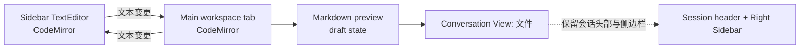

# DSH Main File Tabs

> 在 DSH 主工作区里继续编辑右侧边栏的文件：页签、实时双向同步、边编辑边预览。

[](https://github.com/deepseek-ai/deepseek-harness)
[](https://www.npmjs.com/package/dsh-main-file-tabs)
[](#requirements)
[](LICENSE)
[](https://github.com/l741589/dsh-main-file-tabs)

**DSH Main File Tabs** 是一个面向 [DeepSeek Harness (DSH)](https://github.com/deepseek-ai/deepseek-harness) 的客户端插件。它把右侧边栏里正在预览的文件以**页签**形式打开到主工作区，并复用侧边栏同一个 `TextEditor`，因此语法高亮、Markdown 预览、Mermaid、图片解析等都与侧边栏一致。

插件通过 DSH 的 **Conversation View** 承载文件工作区，而不是替换整个会话：会话标题、右侧边栏、侧边栏展开按钮都会保留。

> English summary: Continue editing the file already open in DSH's right Sidebar from a tabbed main workspace, with live two-way text sync and split edit/preview. Reuses the Sidebar's own `TextEditor` rather than reimplementing highlighting or Markdown rendering.

---

## 目录

- [为什么需要它](#为什么需要它)
- [功能](#功能)
- [界面](#界面)
- [环境要求](#requirements)
- [安装](#安装)
- [使用](#使用)
- [工作原理](#工作原理)
- [插件 API](#插件-api)
- [已知限制](#已知限制)
- [故障排查](#故障排查)
- [项目结构](#项目结构)
- [开发](#开发)
- [致谢](#致谢)
- [License](#license)

---

## 为什么需要它

DSH 的右侧边栏适合快速浏览文件，但编辑长文档、宽表格或复杂代码时空间有限；而主工作区通常被会话占用。

这个插件把侧边栏文件“抬”到主工作区，同时保持两边是**同一份文档**：

- 侧边栏输入，主工作区立即更新；
- 主工作区输入，侧边栏立即更新；
- Markdown 可以左边编辑、右边预览，预览随输入刷新；
- 不想占用主工作区时，点「对话」返回聊天，右侧边栏仍然可用。

## 功能

- **一键打开**：右侧边栏文件工具栏右上角的按钮、页签「…」菜单，或原生预览工具栏。
- **主工作区页签**：切换、关闭、中键关闭；文件图标与侧边栏一致。
- **实时双向同步**：基于 CodeMirror 的 `view.dispatch`，约 45ms 内同步到另一侧。
- **与侧边栏完全相同的渲染**：复用侧边栏注册的 `TextEditor`，保留语法高亮、Markdown 预览、Mermaid、TOC、图片解析等能力。
- **边编辑边预览**：Markdown / HTML / JSONL 支持「编辑 / 预览 / 分屏」。
- **不破坏会话布局**：文件工作区是会话的一个 View（「文件」页签），会话头部和右侧边栏始终保留。
- **只读预览**：图片、PDF、HTML 可以从侧边栏原生预览打开到主工作区。
- **插件 API**：`mainFileTabs` 服务允许其他插件打开文件、监听编辑、读取打开列表。
- **中英双语**：跟随 DSH locale。
- **零构建**：纯 JavaScript 客户端插件，安装后不需要构建步骤。

## 界面


打开文件后，会话头部的 View 页签会新增 **「文件」**。文件工作区在这个 View 内渲染，所以右侧边栏不会消失。

## Requirements

- **DSH** `0.2.1-rc.2` 或更高版本，且 profile 带有 Web UI（例如 `desktop` profile）。
- **dsh-better-sidebar** `0.28.x`（插件复用它的 `TextEditor` 和 viewer 注册表）。
- 支持的操作系统：DSH Desktop 支持的平台（Windows / macOS / Linux）。
- 不需要额外 Node 依赖；安装不需要构建脚本。

> 插件目标不是替代 DSH 的文件树或编辑器，而是把侧边栏文件工作区延伸到主区域。

## 安装

### 从 npm 安装（推荐）

```sh
dsh plugin --profile desktop add dsh-main-file-tabs
```

把 `desktop` 换成你的 profile 名称。安装完成后**完全退出并重新打开 DSH**；桌面版如果缩小到托盘，请从托盘退出。重新打开后按 `Ctrl+R` / Cmd+R 刷新页面。

> 安装不会执行构建脚本，通常不会出现 `approve-builds` 提示。

### 从 GitHub 安装（备选）

```sh
dsh plugin --profile desktop add github:l741589/dsh-main-file-tabs
```

适合想固定到某个 commit、或还没有 npm 发布版本的场景。

### 从本地目录安装（开发）

```sh
git clone https://github.com/l741589/dsh-main-file-tabs.git
dsh plugin --profile desktop add ./dsh-main-file-tabs
```

本地安装会以链接方式挂载目录，修改 `client.js` 后刷新页面即可看到变化；Host 半端是空实现，一般不需要重启 Host 进程。

### 确认安装

重启后打开右侧边栏，打开一个 `.md` 文件，工具栏右上角应出现 **「在主工作区打开」** 按钮。

如果按钮没有出现：

1. 确认 `dsh-better-sidebar` 已安装并在当前 profile 中启用；
2. 打开文件页签的「…」菜单，使用「主工作区打开」；
3. 查看 DSH DevTools（桌面版：`F12` 或 `Ctrl+Shift+I`）Console 中是否有 `[dsh-main-file-tabs]` 开头的日志。

## 使用

1. 在右侧边栏打开一个文本文件（`.md` / `.txt` / 代码文件等）。
2. 点击工具栏右上角的 **「在主工作区打开」**，或页签菜单里的同名项。
3. 会话头部会切换到 **「文件」** View，文件以页签形式出现在主工作区。
4. 在任一侧编辑，另一侧会同步：
   - 侧边栏编辑 → 主工作区更新；
   - 主工作区编辑 → 侧边栏更新；
   - Markdown 预览会跟随编辑刷新。
5. Markdown / HTML / JSONL 可以点击工具栏的 **「分屏」**，左侧编辑、右侧预览。
6. 点文件工作区右上角的 **「对话」** 返回聊天 View；右侧边栏和会话头部不会丢失。

## 工作原理

插件不复制侧边栏的编辑器实现，而是复用 `dsh-better-sidebar` 注册的同一个 `TextEditor` 组件和同一个 Markdown 预览渲染器。

- **单一文档源**：主工作区和侧边栏各挂一个 CodeMirror 视图，插件通过 `view.dispatch` 在它们之间转发文本变化。
- **最小差异应用**：按公共前缀/后缀计算单区间修改，保留光标映射，避免整篇替换。
- **预览刷新**：`TextEditor` 的 Markdown 预览读的是内部 `draft` state；插件在远程文本更新时同步这个 state，所以编辑→预览也能实时刷新，且不会重挂编辑器。
- **会话 View 承载**：文件工作区注册在 `conversation.view`，不是全局 `main` panel，因此不会替换会话头部和右侧边栏。



## 插件 API

插件在 Client 端提供 `mainFileTabs` 服务。其他 Client 插件可以：

```js
const api = ctx.get('mainFileTabs')
```

或在模块声明中注入：

```js
export const inject = ['mainFileTabs']

export function apply(ctx) {
  const api = ctx.mainFileTabs
  const off = api.onDidChange((event) => {
    console.log(event.path, event.text)
  })
  ctx.effect(() => off)
}
```

### `openFile(input)`

```js
const handle = ctx.get('mainFileTabs').openFile({
  sessionId: 'session-id',   // 可省略：取当前右栏挂载的会话
  cwd: '/workspace',         // 可省略：从会话列表读取
  path: 'docs/design.md',    // 绝对路径，或相对 cwd
  line: 12,                  // 可选，1-based；会定位到该行
  viewerId: 'markdown',      // 可选；默认按扩展名匹配
  text: undefined,           // 可选：直接提供初始文本
  mtimeMs: undefined,        // 可选：与 text 配套的保存基线
  size: undefined,           // 可选：与 text 配套的大小
})

await handle.ready
// { sessionId, path, tabId, title, viewerId, line }
```

如果文件已经在侧边栏打开且有未保存文本，API 会优先采用侧边栏的实时文本，而不是磁盘旧内容。

| 字段 | 类型 | 说明 |
|---|---|---|
| `sessionId` | `string?` | 目标会话；省略时取当前右栏挂载的会话。指定非当前会话时页签存入该会话，但不自动切换会话 |
| `cwd` | `string?` | 相对路径的基准；省略时从会话列表读取 |
| `path` | `string` | 文件路径（绝对或相对 `cwd`），必填 |
| `line` | `number?` | 打开后定位到的 1-based 行号 |
| `viewerId` | `string?` | 强制使用某个 viewer id；默认按扩展名 |
| `text` | `string?` | 直接提供初始文本，不再从磁盘读取 |
| `mtimeMs` | `number?` | 与 `text` 配套的保存基线 |
| `size` | `number?` | 与 `text` 配套的文件大小 |

返回值是同步的 handle，`handle.ready` 是一个 Promise，在文件读取/页签就绪后解析为同一个 handle。

### 事件

| 方法 | 触发时机 | 事件字段 |
|---|---|---|
| `onDidChange(listener)` | 主工作区或侧边栏的文本文档发生变化（约 45ms 节流） | `sessionId`, `path`, `tabId`, `title`, `text`, `source: 'main' \| 'sidebar'` |
| `onDidOpen(listener)` | 打开的文件读取完成、页签就绪 | `sessionId`, `path`, `tabId`, `title`, `viewerId`, `kind`, `text?` |
| `onDidClose(listener)` | 页签关闭 | `sessionId`, `path`, `tabId`, `title` |

三个方法都返回 disposer：

```js
const off = api.onDidChange(handler)
// 清理
off()
```

### 查询

```js
api.getOpenFiles(sessionId?)   // 打开列表：sessionId/path/tabId/title/viewerId/kind/line/mtimeMs/dirty/text?
api.getText({ sessionId, cwd, path }) // 返回主工作区内存中的当前文本；不存在返回 undefined
```

### 服务元数据

```js
api.version   // '1.0.0'
api.features  // ['openFile','onDidChange','onDidOpen','onDidClose','getOpenFiles','getText']
```

> `mainFileTabs` 是 **Client 服务**，不是 Host 工具；只能在浏览器端插件中使用。

## 已知限制

- **文本格式为主**：只有 `fsRead` 文本格式提供可编辑页签；图片、PDF、HTML 在主工作区是只读预览，Office 文档请在侧边栏预览。
- **保存冲突**：主工作区保存按钮调用同一个 `TextEditor` 的保存逻辑；如果先在主工作区保存、再在侧边栏保存同一文件，侧边栏的 mtime 基线可能过期并提示保存冲突。遇到冲突时在侧边栏点「重新加载」。
- **依赖 `dsh-better-sidebar` 内部结构**：同步依赖它的 CodeMirror 视图和 `TextEditor` 的 draft state。如果侧边栏插件大版本改版，实时同步可能退化为「只在主工作区打开」，但不会影响侧边栏原有功能。
- **旧页签没有按钮**：在插件加载前已经打开的页签，可能不会重新匹配到新的 viewer；使用页签「…」菜单里的「主工作区打开」。
- **草稿只在内存**：主工作区未保存草稿只保存在浏览器内存中，刷新页面会丢失；关闭有未保存修改的页签会弹确认。
- **非当前会话**：通过 API 为目标 `sessionId` 打开文件时，页签存入该会话的工作区，但不会自动切换会话。
- **HTML 预览**：`dsh-better-sidebar` 的 HTML 预览显示的是已保存文件，不展示未保存草稿；Markdown / JSONL 会实时刷新。

## 故障排查

| 现象 | 处理 |
|---|---|
| 文件工具栏没有「在主工作区打开」按钮 | 确认安装了 `dsh-better-sidebar@0.28.x`；或使用页签「…」菜单 |
| 点了没反应 | 查看 DevTools Console 的 `[dsh-main-file-tabs]` 日志；确认当前会话有 View 页签 |
| 会话头部没有「文件」View | 重启 DSH；确认插件已启用并加载（Console 应有 `active` 日志） |
| 右侧边栏在打开文件后消失 | 这是旧版全局主面板的问题；当前版本使用会话 View，应保留侧边栏。若仍出现，请提交 issue 并附 DSH 版本 |
| 编辑→预览不同步 | 更新到最新版本；Console 搜索 `preview draft sync failed` |
| 保存时提示冲突 | 在侧边栏点「重新加载」，再保存 |

提交 issue 时请附上：

- DSH 版本、`dsh-better-sidebar` 版本、操作系统；
- 复现步骤；
- Console 中 `[dsh-main-file-tabs]` 开头的日志。

## 项目结构

```text
.
├── client.js           # 全部 Client UI / 同步 / API
├── index.js            # Host 半端（空实现）
├── cordis.patch.yml    # 插入 main-file-tabs 插件行
├── package.json        # dsh bundle + client 元数据
├── locale/
│   ├── zh.json
│   └── en.json
├── docs/
│   └── images/
│       └── main-file-tabs.png
├── assets/
│   └── icon-180.png
├── screenshots.json
├── icon.svg
├── LICENSE
└── README.md
```

- **`client.js`**：注册侧边栏 viewer 桥、主工作区「文件」View、页签、同步桥、API。
- **`index.js`**：Host 侧不需要逻辑；整个功能在浏览器端。
- **`cordis.patch.yml`**：把 `main-file-tabs` 行插入 DSH profile。
- **`locale/*.json`**：插件管理器的标题/描述与中英文案。
- **`docs/images/main-file-tabs.png`**：README 中的实际界面截图。
- **`assets/icon-180.png`**：插件市场的 180×180 位图图标（`icon.svg` 不能直接作为市场图标）。
- **`screenshots.json`**：市场详情页的截图清单。

## 开发

```sh
git clone https://github.com/l741589/dsh-main-file-tabs.git
cd dsh-main-file-tabs
dsh plugin --profile desktop add .
```

然后完整重启 DSH 并刷新页面。

由于没有构建步骤，修改 `client.js` 后可先尝试刷新页面；如果 DSH 的客户端 HMR 没有接管，重新加载应用即可。

基础检查：

```sh
node --check client.js
node --check index.js
```

开发时建议在 DevTools Console 观察：

```text
[dsh-main-file-tabs] active { textExtensions: 85, viewer: '...', api: 'mainFileTabs@1.0.0' }
```

### API 兼容性

- 服务版本当前为 `1.0.0`。
- 新能力通过 `api.features` 加法式暴露；已有方法签名尽量保持向后兼容。
- 如果必须做破坏性变更，会提升服务主版本并保留旧入口一段时间。


## 致谢

- [DeepSeek Harness](https://github.com/deepseek-ai/deepseek-harness)：插件运行环境与 UI 基础设施。
- [dsh-better-sidebar](https://github.com/omdsh-dev/DSH-better-sidebar)：提供可复用的 `TextEditor`、viewer 注册表和侧边栏文件能力。
- 本项目是社区插件，不属于 DeepSeek 官方项目，也不代表官方立场。

## License

[MIT](LICENSE) © 2026 l741589
